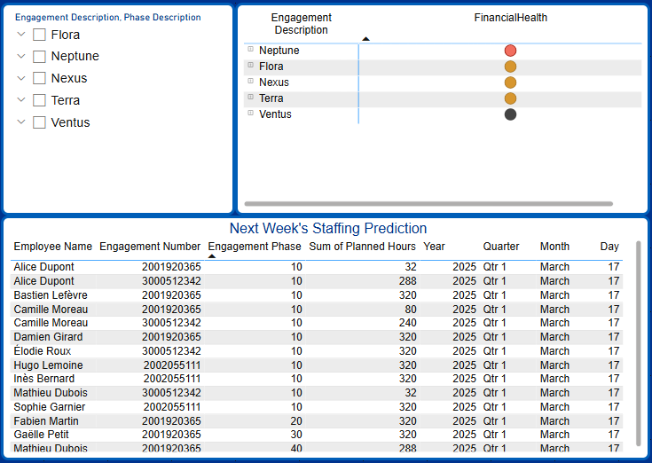
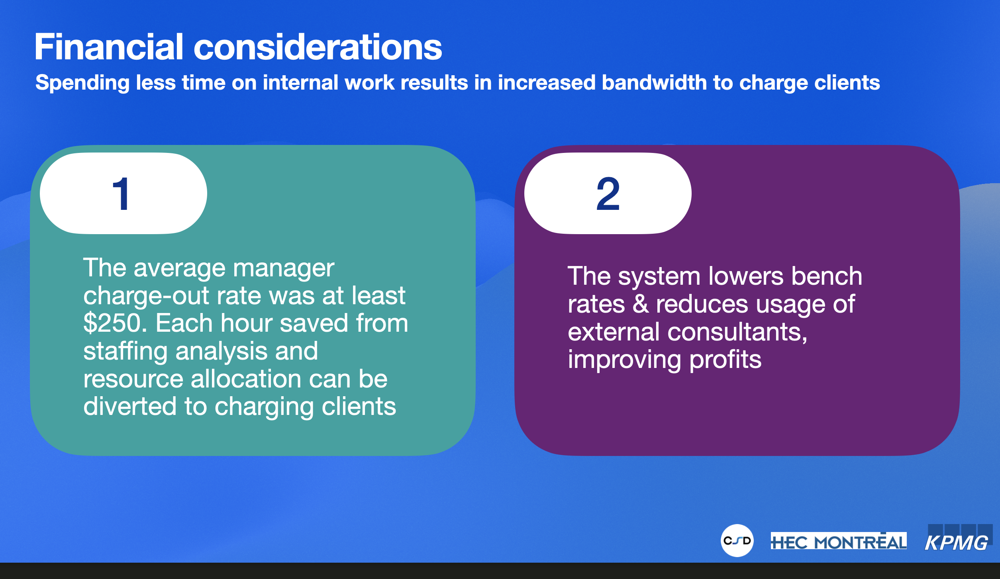
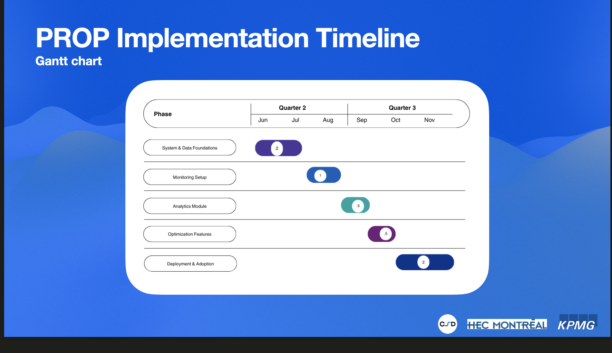

# Predictive Resource Optimization Platform (PROP) - KPMG Case Challenge Submission

<div align="center">

[](https://www.python.org/)
[](https://powerbi.microsoft.com/)
[](https://www.microsoft.com/sql-server)
[](https://www.microsoft.com/excel)

</div>

## 🏆 Team 7

| Team Member | GitHub     | Linkedin                                                                 | Background                                                                                     |
| ----------- | ---------- | ------------------------------------------------------------------------ | ---------------------------------------------------------------------------------------------- |
| Minh        | @vibqetowi | [hminh-software-eng](https://www.linkedin.com/in/hminh-software-eng)        | Software Engineering, previous experience in software development and project management       |
| Carter      | @carterj-c | [cartercameronfina](https://www.linkedin.com/in/cartercameronfina)          | Previously Mechanical Engineering now in Finance, previous experience in aerospace engineering |
| Casey       | @cassius   | [casey-jussaume](https://www.linkedin.com/in/casey-jussaume)                | Finance & Accounting, previous experience in financial modeling and research                   |
| Romero      | @geekpapi  | [romero-p-faustin](https://www.linkedin.com/in/romero-p-faustin-96106a179/) | Economics & Computer Science, previous experience in data analysis                             |


## 🎯 Project Overview

Team 7 presents its submission for the KPMG case challenge: the **Predictive Resource Optimization Platform (PROP)**, focused on optimizing consulting assignment allocation. Leveraging our team's expertise in engineering, economics, project management, and finance, we have developed a solution addressing critical resource allocation challenges common within professional services organizations. While our primary backgrounds are not in direct consulting delivery, our technical skills and project coordination experience inform this solution. PROP is presented as a production-ready Proof of Concept (PoC) dashboard designed to implement enhanced resource management principles, adapting concepts from Earned Value Management (EVM) for the consulting context, to optimize resource allocation across engagements.

This dashboard is specifically engineered to address critical business needs prevalent in consulting practices:

*   Optimizing consultant utilization and minimizing bench time.
*   Maintaining engagement schedules effectively.
*   Maximizing profitability through efficient resource allocation.
*   **Reducing management overhead by approximately 50%**: Significantly decreases the time managers spend on **manual data compilation and internal capacity planning reports**, allowing them to focus on billable client work – directly improving ROI through both cost reduction and revenue enhancement.

### Platform Showcase

#### Main Dashboard


#### Next Week's Staffing Allocation Prediction



## 🌟 Key Capabilities

PROP delivers significant advantages across several key operational areas:

**1. Financial Performance & Profitability**

*   **Enhanced Profitability Visibility:** Provides clear, real-time insight into engagement profitability.
*   **Rapid Financial Analysis:** Delivers instant financial interpretations, including the Value Extraction Coefficient (VEC), Budget Burn Rate, and Schedule Performance Index (SPI).

**2. Resource Management & Optimization**

*   **Optimized Resource Planning:** Supports improved work-life balance through realistic and effective capacity planning.
*   **Intelligent Consultant Allocation:** Features an algorithm for recommending optimized consultant assignments.
*   **Comprehensive Resource Tracking:** Monitors key resource utilization metrics, including bench time and overall capacity utilization.
*   **Integrated Absence Management:** Incorporates vacation and time-off tracking to prevent resource allocation conflicts and ensure realistic capacity assessments.

**3. Project Execution & Performance Management**

*   **Adapted EVM Calculations:** Automatically calculates crucial metrics adapted from Earned Value Management (EVM). **Recognizing the inherent challenge of reliably measuring percentage completion (% Complete) for knowledge work typical in consulting engagements – where progress is often non-linear, milestones can be fluid, and objective quantification is difficult – this PoC adopts a pragmatic approach.** Instead of relying on subjective % Complete estimates, it calculates Earned Value (EV) based on Actual Cost (AC) adjusted by an efficiency factor (see Appendix 4). This provides a more grounded method for tracking progress against plan within the consulting context, alongside Planned Value (PV) and Schedule Performance Index (SPI).
*   **Actionable Performance Insights:** Offers clear visualizations of engagement performance for informed decision-making.
*   **Proactive Variance Management:** Enables effective monitoring of schedule and cost variances to maintain engagement control.
*   **Improved Client Satisfaction:** Facilitates consistent adherence to project deadlines, enhancing client satisfaction (an outcome directly linked to effective project execution).

## 💼 Business Objectives and Optimization Targets

Our solution focuses on key business metrics that drive profitability and efficiency in consulting organizations: maximizing both budget utilization and maintaining target chargeout rates (captured by VEC), while ensuring timely delivery (SPI) and optimal resource usage (Benching Rate, Capacity Utilization Rate), **while addressing critical operational pain points.** These include the **significant administrative burden on resource managers** who often spend considerable time manually aggregating data for planning and reporting, as well as the **inherent difficulty in applying traditional project progress metrics, like percentage completion, to the often non-linear and knowledge-based nature of consulting work.** PROP aims to automate data aggregation and provide more suitable metrics like VEC and adapted SPI to overcome these challenges.

### Value Extraction Coefficient (VEC)

Traditional project management metrics often fail to capture the dual financial objectives of consulting: utilizing the budget effectively while maximizing the value realized from chargeout rates and resource mix. Our Value Extraction Coefficient (VEC) provides executives with a consolidated measure of *financial realization efficiency* relative to the budget for an engagement or phase.

The VEC is calculated as follows (shown for a specific phase $ph$):

$$
VEC_{ph} = \frac{1}{BAC_{ph}} \times \sum_{t=1}^{n} \left[ AC_t \times d_t \times ea_c \times eo_c \right]
$$

Where:

*   $BAC_{ph}$: Budget At Completion for phase $ph$. The $\frac{1}{BAC_{ph}}$ term normalizes the extracted value against the phase budget baseline. (VEC can also be calculated at the engagement level).
*   $\sum_{t=1}^{n}$: Summation over all individual financial transactions $t$ (typically timesheet entries) contributing to the phase's actual cost up to the point of measurement.
*   $AC_t$: Actual Billed Amount (or Cost equivalent) for transaction $t$.
*   $d_t$: Rate Efficiency Factor for transaction $t$, measuring how the actual chargeout rate used compares to the standard rate for the consultant $c$ associated with transaction $t$.
    $$
    d_t = \frac{\text{Chargeout}_t}{\text{StandardChargeout}_c}
    $$
*   $ea_c$: External Adjustment Factor for consultant $c$ (e.g., 1.0 for internal, 0.9 for external).
    $$
    ea_c = 1 - 0.1 \times \text{isExternal}_c
    $$
*   $eo_c$: Onboarding/New Hire Adjustment Factor for consultant $c$ (e.g., 1.0 for experienced, 0.8 for new).
    $$
    eo_c = 1 - 0.2 \times \text{isNew}_c
    $$

#### Interpreting Financial Health (using VEC and Burn)

Budget Burn for a phase is calculated as $\text{Burn}_{ph} = \frac{\sum AC_t}{BAC_{ph}}$. VEC and Burn provide a nuanced view of financial health:

|                     | **VEC > Burn** (Premium Realization) | **VEC ≈ Burn** (Standard Realization) | **VEC < Burn** (Value Dilution) |
| :------------------ | :----------------------------------------- | :------------------------------------------- | :------------------------------------ |
| **Burn < 1**        | Excellent                                  | On Track                                     | Warning                               |
| **Burn ≈ 1**       | Excellent                                  | On Track                                     | Warning                               |
| **Burn > 1**        | Ambiguous                                  | Critical                                     | Critical                              |

**Interpretation Notes:**

*   **Excellent:** High efficiency, within or at budget. Strong performance.
*   **On Track:** Project progressing with minimal value dilution relative to budget consumed.
*   **Warning:** Inefficiency (dilution) detected, even if currently within budget. Potential future problems if trend continues.
*   **Ambiguous:** Over budget, but spend appears efficient relative to budget consumed. Needs investigation: Is the high efficiency justifying the cost (e.g., scope change, premium value delivered), or masking poor overall cost control?
*   **Critical:** Over budget combined with standard or poor efficiency relative to budget consumed. Clear problem with cost control and/or value realization. Requires immediate attention.

### Resource Optimization

Our solution addresses the core optimization challenge facing consulting organizations by recommending optimal consultant assignments. The goal is to dynamically adapt staffing while maintaining project health and efficiency.

**Conceptual Objective Function:**

The optimization seeks the assignment matrix $A$ (consultant $c$, engagement $en$, hours in week $w$) that maximizes overall value, penalized by switching costs and deviations from recent staffing patterns:

$$
\max_{A} \sum_{en \in EN} \left[ w_{en} \times r_{en} \times (\alpha \times SPI_{en} + \beta \times VEC_{en}) \right] - \sum_{c,en,w} pse \times is\_switch_{c,en,w} - \sum_{en, l, pr, w} \text{Penalty}_{l,pr,en,w}
$$

Where:

*   $A$: The assignment matrix being optimized for the upcoming week(s) $w$.
*   $w_{en}$: Strategic value weight of engagement $en$.
*   $r_{en}$: Delivery risk coefficient for engagement $en$.
*   $\alpha, \beta$: Weighting coefficients balancing schedule (SPI) vs. value (VEC).
*   $SPI_{en}, VEC_{en}$: Predicted Schedule Performance Index and Value Extraction Coefficient for engagement $en$ *resulting from* the assignment $A$.
*   $pse$: Phase Switching Efficiency factor (represents cost/penalty incurred for task switching; set to 1 in PoC implying no penalty - see Appendix 3).
*   $is\_switch_{c,en,w}$: Binary variable: 1 if consultant $c$ is newly assigned to engagement $en$ in week $w$ compared to week $w-1$.
*   $\text{Penalty}_{l,pr,en,w}$: A penalty term discouraging significant deviations from the previous week's actual staffing mix for level $l$ and practice $pr$ on engagement $en$. Calculated as:
    $$
    \text{Penalty}_{l,pr,en,w} = \gamma_{l,pr,en} \times \left| \frac{\sum_{c \in C_{l,pr}} \text{Hours}_{c,en,w}}{\sum_{c \in C} \text{Hours}_{c,en,w}} - \text{ActualRatio}_{l,pr,en,w-1} \right|
    $$
    *   $\gamma_{l,pr,en}$: A configurable penalty weight. Higher values enforce stricter adherence to the previous week's ratio for that level/practice/engagement.
    *   $\text{Hours}_{c,en,w}$: The *planned* hours for consultant $c$ on engagement $en$ in week $w$ (part of the decision variable $A$).
    *   $\text{ActualRatio}_{l,pr,en,w-1}$: The *actual* ratio of hours worked by consultants of level $l$ and practice $pr$ on engagement $en$ during the *previous* week ($w-1$), calculated dynamically from the `timesheets` data:
        $$
        \text{ActualRatio}_{l,pr,en,w-1} = \frac{\sum_{c \in C_{l,pr}} \text{ActualHours}_{c,en,w-1}}{\sum_{c \in C} \text{ActualHours}_{c,en,w-1}}
        $$

**(Note:** See Appendix 2 for the adapted objective function used in the demo MILP implementation due to linearity requirements.)

Unsuccessful attempts were made using linear programming: 

**Implementation Notes:**

*   The calculation of `ActualRatio_{l,pr,en,w-1}` from `timesheets` needs to be performed *before* running the optimization for week $w$.
*   The conceptual penalty term adds non-linearity to the objective function, requiring advanced optimization solvers. (The demo implementation uses linearized constraints instead - see Appendix 2).
*   Tuning the `gamma` parameters (or the tolerance `$\delta$` in the demo) will be crucial to balance ratio adherence against other objectives. These could be global or specific (e.g., stored in `optimization_parameters` or linked to engagements).

### Key Performance Indicators (KPIs)

Based on these business objectives, our solution focuses on the following core KPIs enabling proactive management:

1.  **VEC (rolling)**: Value Extraction Coefficient tracking financial realization efficiency.
2.  **Budget Burn (rolling)**: Ratio of Actual Cost to Budget ($\frac{\sum AC}{BAC}$) tracking cost control. *Used with VEC for financial health.*
3.  **SPI (rolling)**: Schedule Performance Index tracking delivery progress against plan (using adapted EV calculation).
4.  **Benching Rate (internal/external)**: Weekly rolling percentage of available capacity *not assigned* to engagements.
5.  **Capacity Utilization Rate (internal/external)**: Weekly rolling ratio of *actual billable hours logged* versus standard capacity.

## 🏗️ Architecture


### Technology Stack

*   **Data Analysis & Optimization**: Python (Pandas, NumPy, PuLP)
*   **Data Storage**: SQL Server database (T-SQL), targeting Azure SQL compatibility.
*   **Visualization**: Power BI
*   **Integration Reference**: Sample pipeline script (`/scripts/pipeline/pipeline.py`) demonstrates ETL from potential source systems (e.g., Salesforce conceptually) to SQL Server. *Requires adaptation for KPMG's specific environment.*

### Database Approach

A dedicated database setup is essential for:

1.  **Advanced Analytics**: Enabling calculations beyond Power BI's native capabilities.
2.  **Complex Optimization**: Providing a structured relational data source for the optimization engine.
3.  **Historical Tracking**: Allowing persistent storage for trend analysis and model refinement.
4.  **Scalability**: Supporting future expansion of data sources and analytical features.

#### Data Model

Interactive ERD available [here](https://dbdiagram.io/d/67e2d56c75d75cc8446be7ea). Static version:


The ERD is implemented in the database, serving as the foundation for the Power BI layer.

#### Vacation Tracking Integration

Incorporates a dedicated `vacations` table:

*   Stores employee planned time-off.
*   Integrates seamlessly with capacity calculations for realistic availability.
*   Provides visual conflict indicators in planning views.
*   Designed for integration with HR systems (uses synthetic data in PoC).
*   Helps avoid resource allocation conflicts due to unaccounted absences.

## 🏢 Business Recommendations




## 🛣️ Production Deployment and Dashboard Improvements Suggestions

The current PoC uses synthesized data; production deployment requires integration with actual KPMG data sources.

### Synthetic Elements and Production Replacements

| PoC Implementation                                                  | Recommended Production Data Source              | Benefit of Production Data                         |
| :------------------------------------------------------------------ | :---------------------------------------------- | :------------------------------------------------- |
| **Vacation Schedules**: Generated synthetically                     | Integration with HR / PTO systems               | Accurate capacity planning                         |
| **Internal/External Status**: Derived heuristically                 | Direct classification from HR / Vendor systems  | Precise resource costing and VEC calculation       |
| **Employment Basis (Capacity)**: Assumed standard work week         | Actual contracted hours per resource            | Accurate capacity for part-time/flexible staff     |
| **Engagement/Phase Timelines**: Inferred from billing dates         | Actual start/end dates from CRM/Project Mgmt    | Precise SPI calculation and forecasting            |
| **Practice Areas**: Defaulted ('SAP')                               | Actual department/practice assignments (HR/CRM) | Correct staffing mix validation & reporting        |
| **Standard Chargeout Rates**: Assumed based on level                | Official rate cards per level/practice/client   | Accurate VEC Rate Efficiency ($d_t$) calculation |
| **Strategic Weight ($w_{en}$)/Risk ($r_{en}$)**: Constant defaults | Defined via business rules/CRM flags/PM input | Optimization reflects true priorities/risk         |
| **New Hire Status ($eo_c$)**: Not implemented                      | Flag from HR system based on tenure             | More accurate VEC reflecting onboarding period     |

## 📝 Implementation Notes

Recommended steps for production deployment:

1.  **System Integration**: Establish robust data pipelines (e.g., APIs, scheduled extracts) from source systems (Salesforce, HR, Project Management tools).
2.  **Replace Synthetic/Assumed Data**: Populate tables with actual data as outlined above.
3.  **Database Deployment**: Implement the SQL schema within KPMG's designated environment (e.g., Azure SQL).
4.  **Data Refresh Scheduling**: Configure regular (e.g., daily or weekly) automated data refreshes.
5.  **User Access Control**: Implement role-based access security aligned with KPMG policies.
6.  **Automated Alert System**: Develop alerts for key KPI thresholds (e.g., low SPI, high bench rate, critical VEC/Burn combination) to enable proactive management.
7.  **Data Quality & Volume Assurance:** Ensure sufficient volume and quality of historical data (timesheets, engagements, outcomes, resource details) for effective model calibration and optimization performance validation. **The PoC development highlighted that limitations in the dataset (e.g., a small number of consultants, data entry errors, missing fields) can significantly constrain the practical application and reliability of advanced optimization techniques.** Robust production deployment requires clean, comprehensive data.
8.  **Parameter Tuning**: Calibrate optimization parameters ($\alpha, \beta, pse, \gamma$ or $\delta$) based on historical data and strategic priorities.

### Dashboard Enhancement Roadmap

Recommended enhancements post-deployment:

1.  **Historical Performance Integration**: Factor past individual consultant performance metrics (e.g., historical VEC contribution, delivery consistency) into the optimization model.
2.  **Skills Taxonomy & Matching**: Implement a detailed skills taxonomy and incorporate skills requirements/matching into the allocation algorithm.
3.  **Dynamic Client Priority ($w_{en}$)**: Allow business leaders to dynamically adjust strategic weights for engagements based on evolving priorities.
4.  **VEC Deeper Analytics**: Add drill-down views to analyze VEC trends by practice, client sector, engagement type, etc.
5.  **Chargeout Discount Monitoring**: Visualize rate realization ($d_t$) trends and discount levels across engagements and clients.
6.  **Refined Switching Penalty ($pse$)**: Calibrate the switching penalty based on analysis of historical data on productivity impacts of context switching.
7.  **Non-Linear Optimization Exploration:** Investigate the use of non-linear solvers or machine learning approaches to handle the conceptual objective function directly, potentially yielding more nuanced results than the linearized demo version.

These steps will evolve the PoC into an indispensable operational tool for resource management and profitability enhancement.

## 🚀 Getting Started

```bash
# Clone the repository
git clone [repository-url]

# Navigate to the project directory
cd [repository-directory]

# Install Python dependencies
pip install -r requirements.txt

# Configure the database connection (update connection strings as needed in configuration files or environment variables)
# Ensure the SQL Server instance is running and the schema (provided) has been deployed

# Open the Power BI dashboard file
open ./dashboards/project_performance.pbix

# Refresh the data connection within Power BI to load data from the database
```

## 📈 Performance Metrics Example

For a sample engagement phase (Code ending 365, Phase 000010), illustrative metrics observed might include:

*   Budget at completion (BAC - Phase): \$2.3M
*   SPI (Schedule Performance Index): 0.95 *(Example value)*
*   VEC (Value Extraction Coefficient): 1.05 *(Example value)*
*   Burn (Budget Burn Rate): 0.60 *(Example value)*
*   *Other relevant KPIs like Benching Rate and Capacity Utilization for assigned consultants would also be displayed.*

## Appendix 1: AI Usage

ChatGPT (free version) and GitHub Copilot were utilized during the development process. Their use included research assistance on technical concepts, brainstorming alternative approaches, generating initial drafts of text content, and providing support for code development and debugging.

## Appendix 2: Predicting Optimal Allocation of Employee Resources (Demo Implementation Strategy)

This section details the algorithmic approach used for solving the resource optimization problem within this demonstration, specifically outlining the strategy using Mixed Integer Linear Programming (MILP), chosen for its tractability in a PoC context. [Reference Video Concept](https://www.youtube.com/embed/E72DWgKP_1Y).

### Implementation Strategy

1.  **Data Preparation Phase (Scheduled - Weekly)**
    *   **Calculate Engagement Status:** Determine current or projected statuses (SPI, VEC, Budget Burn) for active engagements using methods outlined in Appendix 4. Linear approximations or using recent historical values may be necessary input for the linear model.
    *   **Retrieve Consultant Availability:** Fetch each consultant's standard capacity (`employees.employment_basis`), adjusting for planned time off (`vacations`) for the target week(s) $w$.
    *   **Calculate Dynamic Target Ratios:** For each active engagement ($en$), staff level ($l$), and practice ($pr$), calculate the *actual* ratio ($\text{ActualRatio}_{l,pr,en,w-1}$) based on `timesheets.hours` from the most recently completed week ($w-1$), as per the definition in Appendix 4/5. This value serves as the baseline target for the next week's optimization constraints.
    *   **Retrieve Parameters:** Load strategic weights ($w_{en}$) and risk coefficients ($r_{en}$) from `engagements`. Fetch optimization parameters ($\alpha$, $\beta$, $pse$) and the crucial **ratio deviation tolerance** ($\delta$) from the `optimization_parameters` table (or use defaults per Appendix 3 if the table is not populated).

2.  **Optimization Model Formulation (MILP)**
    *   **Framework:** Implemented using Python `PuLP`, a library suitable for defining and solving MILP problems.
    *   **Decision Variables:**
        *   $\text{Hours}_{c,en,w}$: Planned hours for consultant $c$ on engagement $en$ in week $w$ (continuous, non-negative).
        *   $is\_switch_{c,en,w}$: Binary variable (0 or 1) indicating if consultant $c$ starts work on engagement $en$ in week $w$ (having not worked on it in $w-1$).
    *   **Objective Function (Linearized - Demo Implementation):**
        *   **Note:** For this demo implementation using MILP, we adapt the conceptual objective function presented earlier. The non-linear penalty term ($\sum \text{Penalty}_{l,pr,en,w}$) is **replaced by linearized hard boundary constraints** (with tolerance $\delta$, detailed below) and the efficiency factors ignored to manage staffing ratios. Therefore, the objective function optimized in this demo is:
            $$
            \max \sum_{en \in EN} \times (\alpha \times \text{SPI}_{en} + \beta \times \text{VEC}_{en}) 
            $$
        *   *Linearity Requirement:* For this MILP model, $\text{SPI}_{en}$ and $\text{VEC}_{en}$ must be defined as linear functions of the $\text{Hours}_{c,en,w}$ variables. This typically involves simplification, such as assuming contribution is proportional to hours assigned relative to a baseline or using recent historical SPI/VEC as proxies.
    *   **Constraints (Linear):**
        *   **Consultant Capacity:** Total planned hours for each consultant cannot exceed their adjusted weekly availability:
            $$
            \sum_{en \in EN} \text{Hours}_{c,en,w} \leq \text{AdjustedCapacity}_c \quad \forall c, w
            $$
        *   **Staffing Ratio Tolerance (Linearized Hard Constraint):** Enforces that the planned staffing mix for the target week ($w$) stays within the tolerance ($\delta$) of the *previous week's actual ratio* ($\text{ActualRatio}_{l,pr,en,w-1}$). For each engagement $en$, level $l$, practice $pr$, and week $w$:
            *   Let $\text{TargetRatio} = \text{ActualRatio}_{l,pr,en,w-1}$ (pre-calculated constant).
            *   Let $\text{SumHours}_{l,pr} = \sum_{c \in C_{l,pr}} \text{Hours}_{c,en,w}$.
            *   Let $\text{SumHours}_{\text{total}} = \sum_{c \in C} \text{Hours}_{c,en,w}$.
            *   Constraint 1 (Lower Bound): $\text{PlannedRatio} \ge \text{TargetRatio} \times (1-\delta)$
                $$
                \text{SumHours}_{l,pr} \ge \text{TargetRatio} \times (1-\delta) \times \text{SumHours}_{\text{total}}
                $$
                *Rewritten linearly:*
                $$
                (1 - \text{TargetRatio} \times (1-\delta)) \times \text{SumHours}_{l,pr} - \text{TargetRatio} \times (1-\delta) \times \sum_{c \notin C_{l,pr}} \text{Hours}_{c,en,w} \ge 0
                $$
            *   Constraint 2 (Upper Bound): $\text{PlannedRatio} \le \text{TargetRatio} \times (1+\delta)$
                $$
                \text{SumHours}_{l,pr} \le \text{TargetRatio} \times (1+\delta) \times \text{SumHours}_{\text{total}}
                $$
                *Rewritten linearly:*
                $$
                (1 - \text{TargetRatio} \times (1+\delta)) \times \text{SumHours}_{l,pr} - \text{TargetRatio} \times (1+\delta) \times \sum_{c \notin C_{l,pr}} \text{Hours}_{c,en,w} \le 0
                $$
        *   **Performance Thresholds (Optional, Simplified):** If required, constraints like $SPI_{en} \ge 0.85$ would need to be represented linearly based on the $\text{SPI}_{en}$ definition or checked post-optimization.
        *   **Benching Rate Target (Optional):** A constraint could limit total unassigned internal consultant hours relative to their total capacity.
        *   **Internal Resource Priority (Optional):** Constraints could ensure $Hours_{c,en,w} = 0$ for external consultants on certain engagements unless specific internal consultants are fully assigned.
        *   **Switch Logic:** Constraints are needed to correctly define $is\_switch_{c,en,w}$ based on $\text{Hours}_{c,en,w}$ and assignment status in week $w-1$. Typically using "big-M" formulation.

3.  **Solver Execution**
    *   The PuLP model is passed to a compatible MILP solver (e.g., CBC (default), GLPK, Gurobi, CPLEX). The solver attempts to find the optimal $\text{Hours}_{c,en,w}$ and $is\_switch_{c,en,w}$ values that maximize the objective function while satisfying all constraints.

4.  **Post-Optimization Processing & Feedback Loop**
    *   **Output:** Optimal assignments ($\text{Hours}_{c,en,w}$) are saved (e.g., to a `staffing_prediction` table).
    *   **Visualization:** Recommendations are presented clearly on the Power BI dashboard for review by resource managers.
    *   **Monitoring & Tuning:** Actual performance (`timesheets`) is compared to predictions and planned allocations. Optimization parameters ($\alpha, \beta, pse, \delta$) can be manually adjusted based on results and strategic feedback.

5.  **Demo Implementation Considerations**
    *   **Linearity & Simplification:** This strategy prioritizes a solvable MILP model using PuLP. **Crucially, this involved replacing the conceptual non-linear "soft boundary" penalty approach with the linearized "hard boundary" staffing ratio constraints (allowing $\delta$ tolerance) described above.** Projections for SPI/VEC contributions within the model are also simplified to maintain linearity.
    *   **Adaptive Target:** Reliance on the previous week's actual ratio makes the plan adaptive but potentially sensitive to anomalies in past data. The tolerance parameter $\delta$ provides flexibility to mitigate this.
    *   **Future Enhancements:** Production systems could explore non-linear solvers to handle the original conceptual objective, incorporate detailed skills matching, implement more sophisticated predictive models for SPI/VEC, and potentially add constraints to enhance allocation stability over time.

**Optimization Challenges Encountered:**

During initial development exploring optimization approaches, we discovered that the problem's inherent complexity, particularly the high dimensionality arising from numerous consultant-engagement-phase combinations and the interdependencies between staffing mix and performance metrics (VEC, SPI), made it challenging for standard linear programming techniques alone. Attempts to formulate the problem strictly linearly often resulted in models that either oversimplified the reality or failed to converge efficiently.

This highlighted that robust resource allocation in this context exhibits non-linear characteristics. This complexity **was further compounded in the PoC by limitations observed in the provided dataset, including a relatively small number of distinct consultants and potential data inconsistencies, which hindered robust testing and validation of the optimization model.** Achieving higher fidelity optimization in a production environment with richer data could involve exploring:

1.  **Non-linear optimization techniques:** Employing solvers capable of handling non-linear objective functions and constraints directly.
2.  **Heuristic or Metaheuristic approaches:** Utilizing algorithms like genetic algorithms or simulated annealing, which can explore complex solution spaces effectively.
3.  **Machine Learning integration:** For instance, exploring sequence-to-sequence models like **Transformers**, which excel at understanding context, to predict future optimal staffing matrices based on historical assignments, performance, and engagement characteristics. However, such approaches typically require substantial amounts of clean historical data for effective training.
4.  **Simulation techniques:** Employing methods like **Monte Carlo simulation** to model uncertainty (e.g., in project duration, resource availability) and evaluate the robustness of different allocation strategies under various potential future scenarios.
5.  **Decomposition strategies:** Breaking the large-scale problem into smaller, more manageable sub-problems (e.g., optimizing by practice area or engagement type).

## Appendix 3: Modelling Assumptions

This appendix outlines the key assumptions underpinning the analysis presented in this document. These assumptions were necessary due to data limitations or for simplification in the Proof of Concept modelling process. They are categorized into critical and supporting assumptions.

### **Critical Assumptions**

1.  **Cost Performance Index (CPI) Proxy for EV Calculation is set at 0.98.**
    *   **Basis:** In lieu of reliable % Complete data for traditional EV calculation, this PoC uses an efficiency factor (conceptually similar to CPI) applied to Actual Cost to estimate Earned Value (`EV = AC * 0.98`). The 0.98 value is an initial estimate, loosely based on standard project contingency ideas and assumed operational efficiency.
    *   **Impact:** Enables calculation of SPI (`SPI = EV/PV`) within the EVM framework adapted for consulting. **Recommendation:** This factor should be refined or replaced with empirically derived efficiency measures based on actual project performance data and potentially linked to VEC trends in a production environment.

### **Supporting Assumptions**

1.  **Phase Duration Estimation is Based on Staff Allocation.**
    *   **Impact:** Initial project phase duration estimates can be derived by dividing the total budgeted effort (estimated from budget and average rates) by the planned personnel allocation (number of FTEs). This aids in projecting completion dates based on planned resource assignments for PV calculations.
2.  **Staffing Level Distribution is Relatively Consistent Across Phases within an Engagement.**
    *   **Basis:** Analysis of sample engagement data suggested relatively stable ratios in staff levels (e.g., Consultant, Manager) across different phases of the *same* engagement.
    *   **Impact:** Allows for the calculation of reasonably representative weighted average chargeout rates for initial engagement estimations or where phase-specific rates are unavailable.
3.  **Project Phases Progress Sequentially for PV Calculation.**
    *   **Impact:** Projects are assumed to progress linearly through defined phases without significant overlap for the purpose of calculating Planned Value (PV) based on phase timelines.
4.  **Phase Start Date is the First Logged Work Date for that Phase.**
    *   **Impact:** In the absence of explicitly defined phase start dates in the dataset, this definition provides a consistent reference point for timeline analysis (Days Elapsed, Schedule % Elapsed).
5.  **Client Identity is Uniquely Determined by Client Number.**
    *   **Basis:** Standard database practice; the unique client number serves as the primary key for client identification.
    *   **Impact:** Ensures data integrity and enables consistent client tracking and aggregation across engagements.
6.  **Staff at Equivalent Levels/Practices are Functionally Interchangeable (Excluding Switching Costs).**
    *   **Impact:** For initial modelling, personnel within the same practice and at the same level are considered functionally equivalent regarding task execution capability. The Phase Switching Efficiency factor (`pse`) was set to **1** in the PoC optimization model, **explicitly assuming no productivity loss or time cost associated with a consultant switching between different engagements or phases.** This simplification was made to reduce model complexity for the PoC. In a production environment, `pse` should be calibrated (likely to a value < 1 or represented as a cost penalty) to reflect the realistic overhead and learning curve adjustments associated with context switching.
7.  **All Engagements Have Equal Strategic Weight ($w_{en}=1$) Initially.**
    *   **Basis:** Absence of specific prioritization criteria in the initial dataset.
    *   **Impact:** Simplifies initial optimization modelling. **Recommendation:** Incorporate actual strategic weights from business input or CRM data.
8.  **All Engagements Carry Uniform Risk ($r_{en}=1$) Initially.**
    *   **Basis:** Project-specific risk data was not available for this analysis.
    *   **Impact:** Facilitates simplified preliminary analysis. **Recommendation:** Include risk differentiation based on defined criteria or PM assessments.
9.  **Negative Hour Logs Represent Adjustments within the Same Client's Portfolio.**
    *   **Basis:** Observed data patterns suggest negative timesheet entries often correlate with other positive entries for the same client, potentially representing budget transfers or corrections.
    *   **Impact:** Negative hours are treated as adjustments reducing the overall AC for the client/engagement. Further validation with business process owners is recommended.
10. **Time Reporting Timeliness Varies (Heuristic for Internal/External Proxy).**
    *   **Basis:** Analysis revealed variations in timesheet submission lag. A heuristic was used in the PoC: consultants with average lag < 3 days were *provisionally* classified as 'external' (excluding senior managers) for differentiated analysis.
    *   **Impact & Recommendation:** This allows exploring potential differences but requires validation and replacement with actual employment status data from HR systems for accurate `ea_c` calculation.
11. **External Consultants Have a 10% Profitability Adjustment Factor ($ea_c = 0.9$).**
    *   **Basis:** A preliminary estimate applied due to lack of specific cost differential data.
    *   **Impact:** Adjusts the VEC calculation (`ea_c`) to account for potential margin differences. **Recommendation:** Validate and refine this factor based on actual internal cost vs. external vendor rates.
12. **Chargeout Rates are Negotiated Per Engagement.**
    *   **Basis:** Data analysis indicates that a consultant's chargeout rate (`timesheets.charge_out_rate`) can be consistent within one engagement but may vary across different engagements they work on.
    *   **Impact:** Supports the calculation of the Rate Efficiency Factor ($d_t$) in VEC using the engagement-specific actual rate compared to the consultant's standard rate.

## Appendix 4: Key Metrics Derivation

### Database Field References for Key Metrics

This section provides specific database field mappings and calculation logic for key metrics described conceptually in the main document.

#### Current Date Reference for Metrics Calculation

*   **Definition**: When calculating metrics requiring a reference to "today" or "current date" (e.g., for calculating progress to date), the system uses the **maximum `timesheets.work_date` available in the database**.
*   **Rationale**: This reflects standard dashboard practice, grounding calculations in the most recent data recorded in the system.
*   **Implementation**: In SQL queries, "CURRENT\_DATE" or equivalent should be derived as `SELECT MAX(work_date) FROM timesheets`.

#### Budget at Completion (BAC)

*   **Database Source**: `phases.budget` for a specific engagement phase.
*   **Purpose**: Represents the total approved budget for the phase, serving as the financial baseline.

#### Weighted Average Chargeout Rate (Estimation Aid)

*   **Formula**:
    $$
    \text{WeightedRate}_{ph} = \sum_{l=1}^{m} (\text{charge\_out\_rates.standard\_chargeout\_rate}_{l} \times \frac{\sum \text{staffing.planned\_hours}_{l}}{\sum \text{staffing.planned\_hours}})
    $$
*   **Purpose**: Proof of Concept estimation of the average standard rate for a phase based on the *planned* staffing mix by *level*. Used primarily for initial duration/effort estimates when actual billing data is limited.

#### Staffing Ratio Per Phase (Actual, Historical)

*   **Formula**:
    $$
    \text{StaffingRatio}_{l,ph} = \frac{\sum \text{timesheets.hours}_{l,ph}}{\sum \text{timesheets.hours}_{ph}}
    $$
*   **Purpose**: Calculates the actual historical ratio of hours contributed by staff level to the total hours logged for a specific phase. Used for deriving staffing ratio targets in the optimization.

#### Hours Required / Estimated Duration (Estimation Aids)

*   **Formulae**:
    $$
    \text{Hours}_{\text{required\_est},ph} = \frac{\text{phases.budget}_{ph}}{\text{WeightedRate}_{ph}}
    $$
    $$
    \text{Duration}_{\text{est},ph} = \frac{\text{Hours}_{\text{required\_est},ph}}{\sum (\text{staff\_count}_{l} \times \text{daily\_hours\_per\_FTE})}
    $$
*   **Purpose**: PoC estimation of total effort (hours) and timeline (duration) for a phase, based on budget and estimated average rates/staffing. Used primarily for PV calculation inputs.

#### Days Elapsed

*   **Formula**: $\text{DaysElapsed}_{ph} = \text{CURRENT\_DATE} - \text{phases.start\_date}_{ph}$ (using `MAX(timesheets.work_date)` as CURRENT_DATE)
*   **Purpose**: Measures time progression since the phase started.

#### Percentage Schedule Elapsed

*   **Formula**: $\text{Schedule}\%_{ph} = \frac{\text{DaysElapsed}_{ph}}{(\text{phases.end\_date}_{ph} - \text{phases.start\_date}_{ph})}$
*   **Purpose**: Standardizes schedule progress measurement, used for calculating Planned Value (PV). Assumes linear progress over the planned duration.

#### Actual Cost (AC)

*   **Formula**: $AC_{\text{to date},ph} = \sum_{t=1}^{n} (\text{timesheets.std\_price}_{t} + \text{timesheets.adm\_surcharge}_{t})$ for phase $ph$ up to the current date.
*   **Purpose**: Calculates the cumulative actual expenditure recorded against the phase to date.

#### Value Extraction Coefficient (VEC)

*   **Formula**:
    $$
    VEC_{ph} = \frac{1}{\text{phases.budget}_{ph}} \times \sum_{t=1}^{n} [(\text{timesheets.std\_price}_{t} + \text{timesheets.adm\_surcharge}_{t}) \times d_{t} \times ea_{c} \times eo_{c}]
    $$
    Where:
    *   $d_{t} = \frac{\text{timesheets.charge\_out\_rate}_t}{\text{charge\_out\_rates.standard\_chargeout\_rate}_c}$ (Rate Efficiency)
    *   $ea_{c} = 1 - 0.1 \times \text{employees.is\_external}_c$ (External Adjustment)
    *   $eo_{c} = 1 - 0.2 \times \text{isNew}_c$ (Onboarding Adjustment - `isNew_c` is a derived field based on employee tenure)
*   **Purpose**: Measures financial realization efficiency relative to budget.

#### Budget Burn

*   **Formula**: $\text{Burn}_{ph} = \frac{AC_{\text{to date},ph}}{\text{phases.budget}_{ph}}$
*   **Purpose**: Tracks cost consumption relative to the total phase budget.

#### Planned Value (PV)

*   **Formula**: $PV_{ph} = \text{phases.budget}_{ph} \times \text{Schedule}\%_{ph}$
*   **Purpose**: Represents the budgeted cost of work scheduled to have been completed by the current date.

#### Earned Value (EV) - Adapted PoC Method

*   **Formula (PoC Method)**: $EV_{ph} = AC_{\text{to date},ph} \times 0.98$ (using the assumed CPI proxy from Appendix 3)
*   **Purpose**: Represents the estimated value of work completed, **adapted for the consulting context where traditional % Complete is difficult to measure reliably.**

#### Schedule Performance Index (SPI)

*   **Formula**: $SPI_{ph} = \frac{EV_{ph}}{PV_{ph}}$
*   **Purpose**: Quantifies schedule efficiency (actual progress value vs planned progress value). An SPI < 1 indicates being behind schedule.

#### Weekly Benching Rate

*   **Formula**: $\text{Benching Rate}_{w} = \left(1 - \frac{\sum_{c, en} \text{staffing.planned\_hours}_{c,en,w}}{\sum_{c} \text{employees.employment\_basis}_c}\right) \times 100\%$ 
*   **Definition**: Percentage of total available internal consultant capacity *not assigned* to specific engagements in week $w$.
*   **Purpose**: KPI measuring unallocated internal resource time, filtered where `employees.is_external = 0`.

#### Weekly Capacity Utilization Rate

*   **Formula**: $\text{Capacity Utilization}_{c,w} = \frac{\sum_{en} \text{timesheets.hours}_{c,en,w}}{\text{employees.employment\_basis}_c} \times 100\%$
*   **Definition**: Percentage of consultant's contracted weekly capacity utilized in *actual logged billable hours* during a specific week.
*   **Purpose**: KPI measuring productive engagement time relative to capacity.

#### Weekly Assignment Realization Rate (Internal Metric)

*   **Formula**: $\text{Assignment Realization Rate}_{c,w} = \frac{\sum_{en} \text{timesheets.hours}_{c,en,w}}{\sum_{en} \text{staffing.planned\_hours}_{c,en,w}}$
*   **Definition**: Ratio of actual hours logged by consultant in a week compared to the hours they were *planned* or *assigned*.
*   **Purpose**: Internal metric useful for assessing the accuracy of planning and forecasting.

## Appendix 5: Mathematical Notation Conventions

This appendix documents the standardized notation used in formulas throughout this document to ensure consistency and clarity.

### Suffix Conventions

All variables in formulas use consistent suffixes to denote the entity they refer to:

| Suffix | Entity                | Example                                | Description                                      |
| :----- | :-------------------- | :------------------------------------- | :----------------------------------------------- |
| `c`    | Consultant/Employee   | $ea_c$ (External Adjustment)           | Refers to a specific consultant/employee         |
| `t`    | Transaction/Timesheet | $AC_t$ (Actual Cost of transaction)    | Refers to a specific timesheet entry             |
| `ph`   | Phase                 | $VEC_{ph}$ (VEC of a phase)            | Refers to a specific engagement phase            |
| `en`   | Engagement            | $SPI_{en}$ (SPI of engagement)         | Refers to a specific engagement                  |
| `l`    | Staff Level           | $\text{StaffingRatio}_{l,ph}$         | Refers to a specific staff level (e.g., Manager) |
| `pr`   | Practice              | $C_{l,pr}$ (Consultants in practice)   | Refers to a practice area (e.g., SAP)            |
| `w`    | Week                  | $\text{Hours}_{c,en,w}$ (Weekly hours) | Refers to a specific week (time period)          |

### Core Variables and Factors

#### Key Metrics & Financial Variables

| Variable   | Definition                  | Source/Calculation Reference |
| :--------- | :-------------------------- | :--------------------------- |
| $AC_t$     | Actual Cost (transaction)   | `timesheets` fields          |
| $AC_{ph}$  | Actual Cost (phase to date) | Sum of $AC_t$ for phase $ph$ |
| $BAC_{ph}$ | Budget at Completion (phase)| `phases.budget`              |
| $PV_{ph}$  | Planned Value (phase)       | Appendix 4 formula           |
| $EV_{ph}$  | Earned Value (phase, PoC)   | Appendix 4 formula           |
| $SPI_{ph}$ | Schedule Performance Index  | $EV_{ph} / PV_{ph}$          |
| $VEC_{ph}$ | Value Extraction Coefficient| Appendix 4 formula           |
| $\text{Burn}_{ph}$| Budget Burn Rate     | $AC_{ph} / BAC_{ph}$         |

#### Adjustment Factors

| Factor | Definition                            | Formula / Source                                                                          | Purpose                                                    |
| :----- | :------------------------------------ | :---------------------------------------------------------------------------------------- | :--------------------------------------------------------- |
| $d_t$  | Rate Efficiency Factor                | $\frac{\text{timesheets.charge\_out\_rate}_t}{\text{charge\_out\_rates.standard\_rate}_c}$ | Measures charge-out rate efficiency vs. standard           |
| $ea_c$ | External Adjustment Factor            | $1 - 0.1 \times \text{employees.is\_external}_c$ (configurable)                        | Accounts for external consultants' impact on profitability |
| $eo_c$ | Onboarding/New Hire Adjustment Factor | $1 - 0.2 \times \text{isNew}_c$ (configurable)                                         | Accounts for newer consultants' learning curve             |
| $pse$  | Phase Switching Efficiency Penalty    | Configurable parameter                                                                    | Cost/penalty factor applied when switching engagements (**Note:** Set to 1, implying no penalty/loss, in PoC simplification) |

#### Optimization Parameters

| Parameter           | Definition                              | Range/Default / Source                  | Notes                                                          |
| :------------------ | :-------------------------------------- | :-------------------------------------- | :------------------------------------------------------------- |
| $\alpha$            | SPI weight in objective                 | [0, 1], Default: 0.5                    | From `optimization_parameters` table                           |
| $\beta$             | VEC weight in objective                 | [0, 1], Default: 0.5                    | From `optimization_parameters` table                           |
| $w_{en}$            | Strategic weight of engagement          | $\ge 0$, Default: 1.0                   | From `engagements.strategic_weight` or business input          |
| $r_{en}$            | Risk coefficient of engagement          | $\ge 0$, Default: 1.0                   | From `engagements.risk_coefficient` or risk assessment       |
| $\gamma_{l,pr,en}$  | Staffing Ratio Penalty Weight           | $\ge 0$                                 | Configurable parameter for non-linear conceptual model       |
| $\delta$            | Staffing Ratio Tolerance                | [0, 1], e.g., 0.1 (10%)                 | Configurable parameter for linearized demo model (Appendix 2)|
| $\text{ActualRatio}_{l,pr,en,w-1}$ | Prev. Week Actual Staffing Ratio | Calculated from `timesheets` data | Baseline ratio for deviation penalty/constraint              |

## Appendix 6: ETL (Extract, Transform, and Load) Pipeline

This section describes the Proof of Concept (PoC) pipeline designed to automate data extraction, transformation, and loading into the target SQL Server database for the KPMG Data Challenge project. While this PoC utilizes CSV and Excel files as data sources, a production implementation would involve direct connections to source systems like Salesforce, HR platforms, and project management tools via APIs or database links.

### Getting Started (PoC Instructions)

1.  **Install Dependencies:** Ensure all required Python libraries are installed:
    ```bash
    pip install -r requirements.txt
    ```
2.  **Configure Database Connection:** Set up the necessary database connection string (e.g., in a `.env` file or environment variables) for the target SQL Server instance.
3.  **Run Unified Pipeline Script:** Execute the main pipeline script, providing paths to input data and output directories:
    ```bash
    python pipeline.py 
    ```
    *   This script typically orchestrates the steps below.
4.  **Alternatively, Run Pipeline Components Individually:**
    *   **Extract/Convert:** If starting from Excel, convert relevant sheets to CSV.
        ```bash
        python excel_to_csv.py 
        ```
    *   **Transform:** Apply data cleaning, enrichment, and calculation logic.
        ```bash
        python data_transformation.py 
        ```
    *   **Generate Load Scripts:** Create SQL DML statements for inserting/updating data.
        ```bash
        python DML_writer.py 
        ```
5.  **Execute DML:** Run the generated `output_dml.sql` script against the target SQL Server database to populate the tables.

