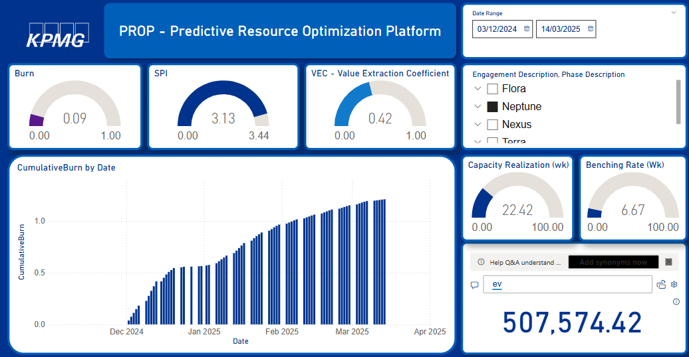
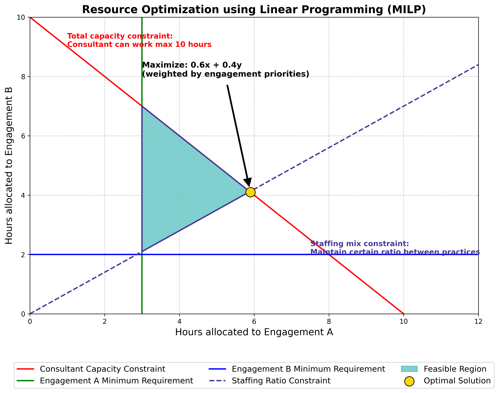
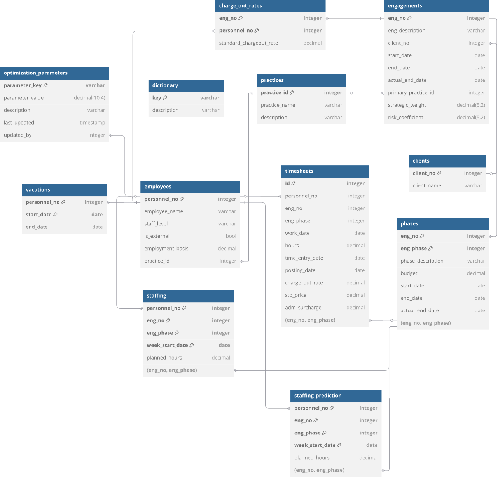

# yPredictive Resource Optimization Platform (PROP) - KPMG Case Challenge Submission

<div align="center">

[](https://www.python.org/)
[](https://powerbi.microsoft.com/)
[](https://www.microsoft.com/sql-server)
[](https://www.microsoft.com/excel)

</div>

## 🏆 Team 7

| Team Member | GitHub     | Linkedin                                                                 | Background                                                                                     |
| ----------- | ---------- | ------------------------------------------------------------------------ | ---------------------------------------------------------------------------------------------- |
| Minh        | @vibqetowi | [hminh-software-eng](https://www.linkedin.com/in/hminh-software-eng)        | Software Engineering, previous experience in software development and project management       |
| Carter      | @carterj-c | [cartercameronfina](https://www.linkedin.com/in/cartercameronfina)          | Previously Mechanical Engineering now in Finance, previous experience in aerospace engineering |
| Casey       | @cassius   | [casey-jussaume](https://www.linkedin.com/in/casey-jussaume)                | Finance & Accounting, previous experience in financial modeling and research                   |
| Romero      | @geekpapi  | [romero-p-faustin](https://www.linkedin.com/in/romero-p-faustin-96106a179/) | Economics & Computer Science, previous experience in data analysis                             |

## 🎯 Project Overview

Team 7 is pleased to present its submission for the KPMG case challenge: the **Predictive Resource Optimization Platform (PROP)** focusing on consulting assignment optimization. While our backgrounds are primarily in engineering, economics, project management, and finance rather than consulting, we've leveraged our technical expertise and project coordination experience to develop a solution that addresses resource allocation challenges common to professional services organizations. Our solution is a production-ready dashboard designed to implement enhanced earned value management (EVM) principles to optimize resource allocation across engagements.

This dashboard is specifically engineered to address critical business needs prevalent in consulting practices:

- Optimizing consultant utilization
- Minimizing consultant bench time
- Maintaining engagement schedules effectively
- Maximizing profitability through efficient resource allocation
- **Reducing management overhead by ~50%**: Significantly decreases the time managers spend on internal capacity planning, allowing them to focus on billable client work – directly improving ROI through both cost reduction and revenue enhancement

### Platform Showcase



## 🌟 Key Capabilities

PROP delivers significant advantages across several key operational areas:

**1. Financial Performance & Profitability**

* **Enhanced Profitability Visibility:** Provides clear, real-time insight into engagement profitability.
* **Rapid Financial Analysis:** Delivers instant financial interpretations, includingvalue Extraction Coefficient (VEC), Burn Rate, and Schedule Performance Index (SPI).

**2. Resource Management & Optimization**

* **Optimized Resource Planning:** Supports improved work-life balance through realistic and effective capacity planning.
* **Intelligent Consultant Allocation:** Features an algorithm for optimizing consultant assignments.
* **Comprehensive Resource Tracking:** Monitors key resource utilization metrics, including bench time and overall capacity utilization.
* **Integrated Absence Management:** Incorporates vacation and time-off tracking to prevent resource allocation conflicts and ensure realistic capacity assessments.

**3. Project Execution & Performance Management**

* **Automated EVM Calculations:** Automatically calculates crucial Earned Value Management (EVM) metrics, such as SPI, Earned Value (EV), and Planned Value (PV).
* **Actionable Performance Insights:** Offers clear visualizations of engagement performance for informed decision-making.
* **Proactive Variance Management:** Enables effective monitoring of schedule and cost variances to maintain engagement control.
* **Improved Client Satisfaction:** Facilitates consistent adherence to project deadlines, enhancing client satisfaction. *(This outcome is directly linked to effective project execution)*

## 💼 Business Objectives and Optimization Targets

Our solution focuses on key business metrics that drive profitability and efficiency in consulting organizations: maximizing both budget utilization and maintaining target chargeout rates (captured by VEC), while ensuring timely delivery (SPI) and optimal resource usage (Benching Rate, Capacity Utilization Rate).

### Value Extraction Coefficient (VEC)

Traditional project management metrics often fail to capture the dual financial objectives of consulting: utilizing the budget (not leaving money on the table) while maximizing the value realized from chargeout rates and resource mix. Our Value Extraction Coefficient (VEC) provides executives with a consolidated measure of *financial realization efficiency* relative to the budget for an engagement or phase.

The VEC is calculated as follows (shown for a specific phase $ph$):

```math
VEC_{ph} = \frac{1}{BAC_{ph}} \times \sum_{t=1}^{n} \left[ AC_t \times d_t \times ea_c \times eo_c \right]
```

Where:

* $ BAC_{ph} $: Budget At Completion for phase $ph$. The $ \frac{1}{BAC_{ph}} $ term normalizes the extracted value against the phase budget baseline. (VEC can also be calculated at the engagement level).
* $ \sum_{t=1}^{n} $: Summation over all individual financial transactions $ t $ (typically timesheet entries) contributing to the phase's actual cost up to the point of measurement.
* $ AC_t $: Actual Billed Amount (or Cost equivalent) for transaction $ t $.
* $ d_t $: Rate Efficiency Factor for transaction $ t $, measuring how the actual chargeout rate used compares to the standard rate for the consultant $ c $ associated with transaction $ t $.
  ```math
  d_t = \frac{Chargeout_t}{StandardChargeout_c}
  ```
* $ ea_c $: External Adjustment Factor for consultant $ c $ (e.g., 1.0 for internal, 0.9 for external).
  ```math
  ea_c = 1 - 0.1 \times isExternal_c
  ```
* $ eo_c $: Onboarding/New Hire Adjustment Factor for consultant $ c $ (e.g., 1.0 for experienced, 0.8 for new).
  ```math
  eo_c = 1 - 0.2 \times isNew_c
  ```

#### Interpreting Financial Health (using VEC and Burn)

Budget Burn for a phase is calculated as $\text{Burn}_{ph} = \frac{\sum AC_t}{BAC_{ph}}$. VEC and Burn provide a nuanced view of financial health:

|                     | **VEC > Burn** (Premium Realization) | **VEC ≈ Burn** (Standard Realization) | **VEC < Burn** (Value Dilution) |
| :------------------ | :----------------------------------------- | :------------------------------------------- | :------------------------------------ |
| **Burn < 1**  | Excellent                                  | On Track                                     | Warning                               |
| **Burn ≈ 1** | Excellent                                  | On Track                                     | Warning                               |
| **Burn > 1**  | Ambiguous                                  | Critical                                     | Critical                              |

**Interpretation Notes:**

* **Excellent:** High efficiency, within or at budget. Strong performance.
* **On Track:** Project progressing with minimal dilution.
* **Warning:** Inefficiency (dilution) detected, even if currently within budget. Potential future problems if trend continues.
* **Ambiguous:** Over budget, but spend appears efficient. Needs investigation: Is the high efficiency justifying the cost (e.g., scope change, premium value), or masking poor cost control?
* **Critical:** Over budget combined with standard or poor efficiency. Clear problem with cost control and/or value realization. Requires immediate attention.

### Resource Optimization

Our solution addresses the core optimization challenge facing consulting organizations by recommending optimal consultant assignments. The goal is to dynamically adapt staffing while maintaining project health and efficiency.

**Objective Function:**

The optimization seeks the assignment matrix $A$ (consultant $c$, engagement $en$, hours in week $w$) that maximizes overall value, penalized by switching costs and deviations from recent staffing patterns:

```math
\max_{A} \sum_{en \in EN} \left[ w_{en} \times r_{en} \times (\alpha \times SPI_{en} + \beta \times VEC_{en}) \right] - \sum_{c,en,w} pse \times is\_switch_{c,en,w} - \sum_{en, l, pr, w} Penalty_{l,pr,en,w}
```

Where:

* $A$: The assignment matrix being optimized for the upcoming week(s) $w$.
* $w_{en}$: Strategic value weight of engagement $en$.
* $r_{en}$: Delivery risk coefficient for engagement $en$.
* $\alpha, \beta$: Weighting coefficients balancing schedule (SPI) vs. value (VEC).
* $SPI_{en}, VEC_{en}$: Predicted Schedule Performance Index and Value Extraction Coefficient for engagement $en$ *resulting from* the assignment $A$.
* $pse$: Phase Switching Efficiency factor (penalty for task switching).
* $is\_switch_{c,en,w}$: Binary variable: 1 if consultant $c$ is newly assigned to engagement $en$ in week $w$ compared to week $w-1$.
* $Penalty_{l,pr,en,w}$: A penalty term discouraging significant deviations from the previous week's actual staffing mix for level $l$ and practice $pr$ on engagement $en$. Calculated as:

  ```math
  Penalty_{l,pr,en,w} = \gamma_{l,pr,en} \times \left| \frac{\sum_{c \in C_{l,pr}} Hours_{c,en,w}}{\sum_{c \in C} Hours_{c,en,w}} - ActualRatio_{l,pr,en,w-1} \right|
  ```

  * $\gamma_{l,pr,en}$: A configurable penalty weight. Higher values enforce stricter adherence to the previous week's ratio for that level/practice/engagement.
  * $Hours_{c,en,w}$: The *planned* hours for consultant $c$ on engagement $en$ in week $w$ (part of the decision variable $A$).
  * $ActualRatio_{l,pr,en,w-1}$: The *actual* ratio of hours worked by consultants of level $l$ and practice $pr$ on engagement $en$ during the *previous* week ($w-1$), calculated dynamically from the `timesheets` data:
    ```math
    ActualRatio_{l,pr,en,w-1} = \frac{\sum_{c \in C_{l,pr}} ActualHours_{c,en,w-1}}{\sum_{c \in C} ActualHours_{c,en,w-1}}
    ```

Unsuccessful attempts were made using linear programming: n.png)

**Implementation Notes:**

* The calculation of `ActualRatio_{l,pr,en,w-1}` from `timesheets` needs to be performed *before* running the optimization for week $w$.
* The penalty term adds complexity to the objective function, potentially requiring non-linear optimization solvers depending on the specific formulation and solver capabilities.
* Tuning the `gamma` parameters will be crucial to balance ratio adherence against other objectives. They could be global or specific (e.g., stored in `optimization_parameters` or linked to engagements).

### Key Performance Indicators (KPIs)

Due to these business objectives, our solution focuses on the following core KPIs enabling proactive management:

1. **VEC (rolling)**: Value Extraction Coefficient tracking financial realization efficiency.
2. **Budget Burn (rolling)**: Ratio of Actual Cost to Budget ($\frac{\sum AC}{BAC}$) tracking cost control. *Used with VEC for financial health.*
3. **SPI (rolling)**: Schedule Performance Index tracking delivery progress against plan.
4. **Benching Rate (internal/external)**: Weekly rolling percentage of available capacity *not assigned* to engagements.
5. **Capacity Utilization Rate (internal/external)**: Weekly rolling ratio of *actual billable hours logged* versus standard capacity.

## 🏗️ Architecture


### Technology Stack

- **Data Analysis & Optimization**: Python (Pandas, NumPy, PuLP)
- **Data Storage**: SQL Server database (T-SQL), targeting Azure SQL compatibility.
- **Visualization**: Power BI
- **Integration Reference**: Sample pipeline script (`/scripts/pipeline/pipeline.py`) demonstrates ETL from Salesforce to SQL Server. *Requires adaptation for KPMG's specific environment.*

### Database Approach

A dedicated database setup is essential:

1. **Advanced Analytics**: Enables calculations beyond Power BI's native capabilities.
2. **Complex Optimization**: Provides relational structure for the optimization engine.
3. **Historical Tracking**: Allows persistent storage for trend analysis.
4. **Scalability**: Supports future expansion.

#### Data Model

Interactive ERD: [here](https://dbdiagram.io/d/67e2d56c75d75cc8446be7ea). Static version:


The ERD is implemented in the database, serving the Power BI layer.

#### Vacation Tracking Integration

Incorporates a dedicated `vacations` table:

- Stores employee time-off.
- Integrates with capacity calculations.
- Provides visual conflict indicators.
- Designed for integration with HR systems (uses synthetic data in PoC).
- Helps avoid resource conflicts due to unaccounted absences.

## 🏢 Business Plan

TODO, insert gantt chart and financials

## 🛣️ Production Deployment and Dashboard Improvements Suggestions

PoC uses synthesized data; production requires actual KPMG data.

### Synthetic Elements and Production Replacements

| PoC Implementation                                                  | Recommended Production Data Source              | Benefit of Production Data                         |
| :------------------------------------------------------------------ | :---------------------------------------------- | :------------------------------------------------- |
| **Vacation Schedules**: Generated synthetic                   | Integration with HR / PTO systems               | Accurate capacity planning                         |
| **Internal/External Status**: Derived heuristically           | Direct classification from HR / Vendor systems  | Precise resource costing and VEC calculation       |
| **Employment Basis**: Assumed 40-hour week                    | Actual contracted hours per resource            | Accurate capacity for part-time/flexible staff     |
| **Engagement/Phase Timelines**: Inferred from billing         | Actual start/end dates from CRM/Project Mgmt    | Precise SPI calculation and forecasting            |
| **Practice Areas**: Defaulted ('SAP')                         | Actual department/practice assignments (HR/CRM) | Correct staffing mix validation & reporting        |
| **Standard Chargeout Rates**: Assumed based on level          | Official rate cards per level/practice          | Accurate VEC Rate Efficiency ($d_t$) calculation |
| **Strategic Weight ($w_{en}$)/Risk ($r_{en}$)**: Constant | Defined via business rules/CRM flags            | Optimization reflects true priorities/risk         |

## 📝 Implementation Notes

Recommended steps for production deployment:

1. **System Integration**: Establish robust API integration (e.g., Salesforce, HR).
2. **Replace Temporary Values:** View above table for reccomendations.
3. **Database Deployment**: Implement the SQL schema in KPMG's environment.
4. **Data Refresh Scheduling**: Set up regular (e.g., weekly) data refreshes.
5. **User Access Control**: Implement role-based security.
6. **Automated Alert System**: Develop alerts for KPI thresholds (e.g., low SPI).

### Dashboard Enhancement Roadmap

Recommended enhancements:

1. **Historical Performance Integration**: Factor past consultant performance into optimization.
2. **Skills Taxonomy**: Implement detailed skills matching.
3. **Client Priority Weighting ($w_{en}$)**: Allow dynamic setting of strategic weights.
4. **VEC Deeper Analytics**: Add views to analyze VEC trends by practice, client, etc.
5. **Chargeout Discount Monitoring**: Visualize rate realization ($d_t$) trends.
6. **Calibrated Switching Penalty ($\text{pse}$)**: Set realistic $\text{pse}$ based on historical data.

These steps evolve the PoC into an essential operational tool.

## 🚀 Getting Started

```bash
# Clone repository
git clone [repository-url]

# Navigate to directory
cd [repository-directory]

# Install Python dependencies
pip install -r requirements.txt

# Configure database connection (update connection strings as needed)
# Ensure SQL Server instance is running and schema is deployed

# Open Power BI dashboard
open ./dashboards/project_performance.pbix
# Refresh data within Power BI
```

## 📈 Performance Metrics Example

For a sample engagement phase (Code ending 365, Phase 000010), metrics observed:

- Budget at completion (BAC - Phase): \$2.3M
- SPI: \[Value calculated]
- VEC: \[Value calculated]
- Burn: \[Value calculated]
- *Other relevant KPIs like Benching/Capacity Utilization can be shown here.*

## Appendix 1: AI Usage

ChatGPT (free version) and GitHub Copilot were utilized during development for research assistance, conceptual brainstorming, content generation, and code development support.

## Appendix 2: Predicting Optimal Allocation of Employee Resources (Demo Implementation Strategy)

This section details the algorithmic approach for solving the resource optimization problem, specifically outlining the strategy for this demonstration using Mixed Integer Linear Programming (MILP) [see video.](https://www.youtube.com/embed/E72DWgKP_1Y).

### Implementation Strategy

1. **Data Preparation Phase (Scheduled - Weekly)**

   * **Calculate Engagement Status:** Determine current or projected statuses (SPI, VEC, Budget Burn) for active engagements using methods outlined in Appendix 4. Linear approximations may be needed if using these directly in the objective/constraints.
   * **Retrieve Consultant Availability:** Fetch each consultant's standard capacity (`employees.employment_basis`), adjusting for planned time off (`vacations`) for the target week(s) $w$.
   * **Calculate Dynamic Target Ratios:** For each active engagement ($en$), staff level ($l$), and practice ($pr$), calculate the *actual* ratio ($ActualRatio_{l,pr,en,w-1}$) based on `timesheets.hours` from the most recently completed week ($w-1$), as per the definition in Appendix 4/5. This value serves as the baseline target for the next week's optimization constraints.
   * **Retrieve Parameters:** Load strategic weights ($w_{en}$) and risk coefficients ($r_{en}$) from `engagements`. Fetch optimization parameters ($\alpha$, $\beta$, $pse$) and the **ratio deviation tolerance** ($\delta$) from the `optimization_parameters` table (or use defaults per Appendix 3 if table not populated).
2. **Optimization Model Formulation (MILP)**

   * **Framework:** Implemented using **Python `PuLP`**, a library suitable for defining and solving MILP problems.
   * **Decision Variables:**

     * $Hours_{c,en,w}$: Planned hours for consultant $c$ on engagement $en$ in week $w$ (continuous).
     * $is\_switch_{c,en,w}$: Binary variable (0 or 1) indicating if consultant $c$ starts work on engagement $en$ in week $w$ (having not worked on it in $w-1$).
   * **Objective Function (Linear - Demo Implementation):**

     * **Note:** For this demo implementation using MILP, we are **using a hard boundary constraint** (with tolerance $\delta$, detailed below) to manage staffing ratios, **instead of the non-linear penalty term** ($\sum \text{Penalty}_{l,pr,en,w}$) described conceptually earlier in the document. Therefore, the objective function optimized in this demo is:

     ```math
     \max \sum_{en \in EN} \left[ w_{en} \times r_{en} \times (\alpha \times \text{Proj\_SPI\_Contrib}_{en} + \beta \times \text{Proj\_VEC\_Contrib}_{en}) \right] - \sum_{c,en,w} \text{pse} \times \text{is\_switch}_{c,en,w}
     ```

     * *Linearity Requirement:* For this MILP model, $\text{Proj\_SPI\_Contrib}_{en}$ and $\text{Proj\_VEC\_Contrib}_{en}$ must be defined as linear functions of the $Hours_{c,en,w}$ variables. Simplifications (e.g., assuming contribution is proportional to hours assigned relative to a target) may be necessary.
   * **Constraints (Linear):**

     * **Consultant Capacity:** Total planned hours for each consultant cannot exceed their adjusted weekly availability:
       ```math
       \sum_{en \in EN} Hours_{c,en,w} \leq \text{AdjustedCapacity}_c \quad \forall c, w
       ```
     * **Staffing Ratio Tolerance (Linearized Hard Constraint):** Enforces that the planned staffing mix for the target week ($w$) stays within the tolerance ($\delta$) of the *previous week's actual ratio* ($ActualRatio_{l,pr,en,w-1}$). For each engagement $en$, level $l$, practice $pr$, and week $w$:
       * Let $\text{TargetRatio} = ActualRatio_{l,pr,en,w-1}$ (pre-calculated constant).
       * Let $\text{SumHours}_{l,pr} = \sum_{c \in C_{l,pr}} Hours_{c,en,w}$.
       * Let $\text{SumHours}_{\text{other}} = \sum_{c \notin C_{l,pr}} Hours_{c,en,w}$.
       * Constraint 1 (Lower Bound): Ensures $\text{PlannedRatio} \ge \text{TargetRatio} \times (1-\delta)$
         ```math
         (\text{TargetRatio} \times (1-\delta) - 1) \times \text{SumHours}_{l,pr} + \text{TargetRatio} \times (1-\delta) \times \text{SumHours}_{\text{other}} \leq 0
         ```
       * Constraint 2 (Upper Bound): Ensures $\text{PlannedRatio} \le \text{TargetRatio} \times (1+\delta)$
         ```math
         (1 - \text{TargetRatio} \times (1+\delta)) \times \text{SumHours}_{l,pr} - \text{TargetRatio} \times (1+\delta) \times \text{SumHours}_{\text{other}} \leq 0
         ```
     * **Performance Thresholds (Simplified/Linearized):** If required, constraints like $SPI_{en} \ge 0.85$ must be represented linearly or checked post-optimization.
     * **Benching Rate:** A constraint limiting total unassigned internal consultant hours relative to their total capacity.
     * **Internal Priority:** Constraints ensuring $Hours_{c,en,w} = 0$ for external consultants unless specific internal consultants are fully assigned.
     * **Switch Logic:** Constraints defining $is\_switch_{c,en,w}$ based on $Hours_{c,en,w}$ and assignment status in week $w-1$.
3. **Solver Execution**

   * The PuLP model is passed to a compatible MILP solver (e.g., CBC, GLPK, Gurobi, CPLEX). The solver finds the optimal $Hours_{c,en,w}$ values.
4. **Post-Optimization Processing & Feedback Loop**

   * **Output:** Optimal assignments ($Hours_{c,en,w}$) are saved (e.g., to `staffing_prediction`).
   * **Visualization:** Recommendations presented on the Power BI dashboard.
   * **Monitoring & Tuning:** Actual performance (`timesheets`) compared to predictions. Parameters ($\alpha$, $\beta$, $pse$, $\delta$) manually adjusted based on results.
5. **Demo Implementation Considerations**

   * **Linearity & Simplification:** This strategy prioritizes a solvable MILP model using PuLP. **Crucially, this involved replacing the non-linear "soft boundary" penalty approach with the linearized "hard boundary" staffing ratio constraints (allowing $\delta$ tolerance) described above.** Projections for SPI/VEC within the model might also be simplified.
   * **Dynamic Target:** Reliance on the previous week's actual ratio makes the plan adaptive but sensitive to past anomalies. $\delta$ provides flexibility.
   * **Future Enhancements:** Could involve exploring non-linear solvers, adding skills matching, improving SPI/VEC predictions, and adding stability constraints.

**Optimization Challenges:**

During implementation, we discovered that the problem's dimensional complexity made it unsuitable for linear programming methods. Each engagement phase created its own dimension in the solution space, resulting in a combinatorial explosion that couldn't be efficiently represented in a linear model. The solver consistently failed to converge to a feasible solution despite various reformulation attempts.

This revealed a fundamental limitation in our approach: resource allocation across multiple phases with different staffing ratios and interdependencies creates a highly non-linear problem space. The visualization above shows one of our earlier attempts at linear programming, but the approach proved inadequate for capturing the full complexity of the optimization challenge.

For a more effective implementation, the problem would require:

1. Non-linear optimization techniques capable of handling high-dimensional solution spaces
2. Potentially neural network approaches that can learn the complex relationships between staffing decisions and performance outcomes
3. Decomposition strategies that break the problem into manageable sub-problems

## Appendix 3: Modelling Assumptions

This appendix outlines the key assumptions underpinning the analysis presented in this document. These assumptions were necessary due to data limitations or for simplification in the modelling process. They are categorized into critical and supporting assumptions.

### **Critical Assumptions**

1. **Cost Performance Index (CPI) is set at 0.98.**
   * **Basis:** This value is derived from standard project management contingency practices (estimated at 10%) and an assumption regarding the operational efficiency of the KPMG workforce.
   * **Impact:** Enables preliminary project timeline estimations based on budget utilization. It is recommended that this assumption be replaced with empirically derived CPI values based on actual project performance data and VEC calculations in future operational applications.

### **Supporting Assumptions**

1. **Phase Duration is Based on Staff Allocation.**

   * **Impact:** Project phase durations are estimated by dividing the total required effort (in hours) for the phase by the number of personnel allocated. This approach facilitates the projection of project completion dates based on planned resource assignments.
2. **Staffing Distribution is Consistent Across Phases.**

   * **Basis:** Analysis of sample engagement data indicates relatively consistent ratios in staff levels (e.g., Consultant, Manager) across different phases.
   * **Impact:** Allows for the calculation of reliable weighted average chargeout rates for engagements.
3. **Project Phases Progress Linearly.**

   * **Impact:** Projects are assumed to progress sequentially through defined phases without significant overlap. This simplification facilitates the calculation of Planned Value (PV) and project schedule projections.
4. **Phase Start Date is the First Logged Work Date.**

   * **Impact:** In the absence of explicitly defined start dates within the dataset, this definition provides a consistent reference point for timeline analysis and management.
5. **Client Identity is Determined by Client Number.**

   * **Basis:** Consistent with standard database management principles, the unique client number is used as the primary identifier for each client.
   * **Impact:** Ensures data integrity and enables consistent client tracking and aggregation across different engagements.
6. **Staff at Equivalent Levels are Interchangeable.**

   * **Impact:** Personnel within the same practice and at the same designated level are considered functionally interchangeable for resource allocation modelling purposes, assuming equivalent productivity (Productivity Substitution Effect, $pse = 1$). This simplifies calculations for cross-project assignments but represents an idealization; it should be refined with performance metrics where available.
7. **All Projects are Equally Important.**

   * **Basis:** Due to the absence of specific prioritization criteria in the available data, all projects within the analyzed dataset are assigned equal importance (project weight, $w_p$ = constant).
   * **Impact:** Simplifies initial optimization modelling. Prioritization factors should be incorporated in subsequent analyses if available.
8. **All Projects Carry Uniform Risk.**

   * **Basis:** Project-specific risk data was not available for this analysis. Consequently, all projects are assumed to carry an equal level of risk (project risk, $r_p$ = constant).
   * **Impact:** Facilitates simplified preliminary analysis; risk differentiation should be included when data permits.
9. **Negative Hour Logs Offset Work on Other Projects for the Same Client.**

   * **Basis:** Observed data patterns suggest this correlation, aligning with common project management practices for budget adjustments.
   * **Impact:** Negative hours are interpreted as adjustments within the client's project portfolio. Further investigation is warranted to fully validate this interpretation.
10. **Time Reporting Behaviours Differ Between Internal and External Consultants.**

    * **Basis:** Analysis revealed significant variations in timesheet submission timeliness, with delays more pronounced among certain senior internal staff.
    * **Impact & Application:** A heuristic was applied for modelling: consultants with an average reporting lag < 3 days were provisionally classified as 'external' (excluding managers+). This allows for differential analysis but requires validation with actual employment status data.
11. **External Consultants Reduce Profitability by 10%.**

    * **Basis:** A preliminary estimate applied due to lack of specific cost data. This rate requires validation.
    * **Impact:** Adjusts the VEC calculation to account for potential differences in resource costs, informing staffing mix decisions.
12. **Chargeout Rates are Negotiated Per Engagement.**

    * **Basis:** Data analysis shows consultant rates are consistent within one engagement but vary across different engagements for the same individual.
    * **Impact:** Enables the tracking of engagement-specific chargeout rates, facilitating more accurate VEC calculations reflecting specific financial terms.

## Appendix 4: Key Metrics Derivation

### Database Field References for Key Metrics

This section provides the specific database field mappings for metrics described conceptually in the main document.

#### Current Date Reference for Metrics Calculation

- **Definition**: When calculating metrics that require a reference to "today" or "current date," the system uses the  work date available in the timesheet data.
- **Rationale**: This reflects standard dashboard practice of using the most recent data in the datalake.
- **Implementation**: In code, "current_date" is set to the maximum work_date in the timesheets table rather than system time.

#### Budget at Completion (BAC)

- **Database Source**: `phases.budget` for engagement phase
- **Purpose**: Financial baseline for a phase.

#### Weighted Average Chargeout Rate (Estimation Aid)

- **Formula**:

```math
Weighted Rate_{ph} = \sum_{l=1}^{m} (charge\_out\_rates.standard\_chargeout\_rate_{l} \times \frac{\sum staffing.planned\_hours_{l}}{\sum staffing.planned\_hours})
```

- **Purpose**: PoC estimation of average rate for a phase based on planned mix.

#### Staffing Ratio Per Phase

- **Formula**:

```math
StaffingRatio_{l,ph} = \frac{\sum timesheets.hours_{l,ph}}{\sum timesheets.hours_{ph}}
```

#### Hours Required / Estimated Duration (Estimation Aids)

- **Formulae**:

  ```math
  Hours_{\text{required\_est},ph} = \frac{phases.budget_{ph}}{Weighted Rate_{ph}}
  ```

  ```math
  Duration_{\text{est},ph} = \frac{Hours_{\text{required\_est},ph}}{\sum (staff\_count_{l} \times daily\_hours)}
  ```
- **Purpose**: PoC estimation of total effort/timeline for a phase.

#### Days Elapsed

- **Formula**: $Days_{\text{elapsed},ph} = CURRENT\_DATE - phases.start\_date_{ph}$
- **Purpose**: Measures time progression.

#### Percentage Schedule Elapsed

- **Formula**: $Schedule\%_{ph} = \frac{Days Elapsed_{ph}}{(phases.end\_date_{ph} - phases.start\_date_{ph})}$
- **Purpose**: Standardizes schedule progress measurement for PV calculation.

#### Actual Cost (AC)

- **Formula**: $AC_{\text{to date},ph} = \sum_{t=1}^{n} (timesheets.std\_price_{t} + timesheets.adm\_surcharge_{t})$
- **Purpose**: Calculates actual expenditure to date.

#### Value Extraction Coefficient (VEC)

- **Formula**:
  ```math
  VEC_{ph} = \frac{1}{phases.budget_{ph}} \times \sum_{t=1}^{n} [(timesheets.std\_price_{t} + timesheets.adm\_surcharge_{t}) \times d_{t} \times ea_{c} \times eo_{c}]
  ```

Where:

- $d_{t} = \frac{timesheets.charge\_out\_rate_t}{charge\_out\_rates.standard\_chargeout\_rate_c}$
- $ea_{c} = 1 - 0.1 \times employees.is\_external_c$
- $eo_{c} = 1 - 0.2 \times isNew_c$ (derived field, not in database)

#### Budget Burn

- **Formula**: $Burn_{ph} = \frac{\sum_{t} (timesheets.std\_price_{t} + timesheets.adm\_surcharge_{t})}{phases.budget_{ph}}$

#### Planned Value (PV)

- **Formula**: $PV_{ph} = phases.budget_{ph} \times Schedule\%_{ph}$
- **Purpose**: Budgeted cost of work scheduled.

#### Earned Value (EV)

- **Formula (PoC Method)**: $EV_{ph} = \sum_{t} (timesheets.std\_price_{t} + timesheets.adm\_surcharge_{t}) \times 0.98$
- **Purpose**: Represents value of work completed with efficiency factor.

#### Schedule Performance Index (SPI)

- **Formula**: $SPI_{ph} = \frac{EV_{ph}}{PV_{ph}}$
- **Purpose**: Quantifies schedule efficiency.

#### Weekly Benching Rate

- **Formula**: $Benching Rate_{c,w} = \left(1 - \frac{\sum hours\_planned_{c,w}}{capacity_c}\right) \times 100\%$
- **Definition**: Percentage of employee's contracted capacity not assigned to engagements.
- **Purpose**: KPI measuring unallocated bench time.

#### Weekly Capacity Utilization Rate

- **Formula**: $Capacity Utilization_{c,w} = \frac{\sum hours\_actual_{c,w}}{capacity_c} \times 100\%$
- **Definition**: Percentage of employee's contracted capacity utilized in billable work.
- **Purpose**: KPI measuring productive engagement.

#### Weekly Assignment Realization Rate (Internal Metric)

- **Formula**: $Assignment Realization Rate_{c,w} = \frac{\sum hours\_actual_{c,w}}{\sum hours\_planned_{c,w}}$
- **Definition**: Ratio of actual hours to assigned hours.
- **Purpose**: Internal metric for planning accuracy assessment.

## Appendix 5: Mathematical Notation Conventions

This appendix documents the standardized notation used in formulas throughout this document to ensure consistency and clarity.

### Suffix Conventions

All variables in formulas use consistent suffixes to denote the entity they refer to:

| Suffix | Entity                | Example                                | Description                                      |
| ------ | --------------------- | -------------------------------------- | ------------------------------------------------ |
| `c`  | Consultant/Employee   | $ea_c$ (External Adjustment)         | Refers to a specific consultant/employee         |
| `t`  | Transaction/Timesheet | $AC_t$ (Actual Cost)                 | Refers to a specific timesheet entry             |
| `ph` | Phase                 | $VEC_{ph}$ (VEC of a phase)          | Refers to a specific engagement phase            |
| `en` | Engagement            | $SPI_{en}$ (SPI of engagement)       | Refers to a specific engagement                  |
| `l`  | Staff Level           | $StaffingRatio_{l,ph}$               | Refers to a specific staff level (e.g., Manager) |
| `pr` | Practice              | $C_{l,pr}$ (Consultants in practice) | Refers to a practice area (e.g., SAP)            |
| `w`  | Week                  | $Hours_{c,en,w}$ (Weekly hours)      | Refers to a specific week (time period)          |

### Core Variables and Factors

#### Adjustment Factors

| Factor   | Definition                            | Formula                                                                                   | Purpose                                                    |
| -------- | ------------------------------------- | ----------------------------------------------------------------------------------------- | ---------------------------------------------------------- |
| $d_t$  | Rate Efficiency Factor                | $\frac{timesheets.charge\_out\_rate_t}{charge\_out\_rates.standard\_chargeout\_rate_c}$ | Measures charge-out rate efficiency                        |
| $ea_c$ | External Adjustment Factor            | $1 - 0.1 \times employees.is\_external_c$                                               | Accounts for external consultants' impact on profitability |
| $eo_c$ | Onboarding/New Hire Adjustment Factor | $1 - 0.2 \times isNew_c$                                                                | Accounts for newer consultants' learning curve             |
| $pse$  | Phase Switching Efficiency            | Assume 1 (no loss) (configurable)                                                         | Productivity loss factor when switching engagements        |

#### Optimization Parameters

| Parameter       | Definition                     | Range/Default                   | Source                            |
| --------------- | ------------------------------ | ------------------------------- | --------------------------------- |
| $\alpha$      | SPI weight in optimization     | 0.5 (default)                   | `optimization_parameters` table |
| $\beta$       | VEC weight in optimization     | 0.5 (default)                   | `optimization_parameters` table |
| $w_{en}$      | Strategic weight of engagement | Default: 1.0                    | `engagements.strategic_weight`  |
| $r_{en}$      | Risk coefficient of engagement | Default: 1.0                    | `engagements.risk_coefficient`  |
| $r_{l,pr,en}$ | Required staffing ratio        | Calculated from historical data | Derived from timesheet data       |

## Appendix 6: ETL (Extract, Transform, and Load) Pipeline

This pipeline is a proof of concept (POC) for automating data extraction, transformation, and loading into a SQL Server database for the KPMG Data Challenge project. In this POC, we're working with CSV and Excel files, but the production implementation would connect directly to Salesforce

### Getting Started

1. Ensure all dependencies are installed: `pip install -r requirements.txt`
2. Configure database connection in `.env` file
3. Run the unified pipeline script:

   ```
   python pipeline.py --excel-file <path_to_excel> --output-dir <path_to_output_dir>
   ```
4. Or run the pipeline components individually:

   ```
   python excel_to_csv.py <excel_file> --output-dir /path/to/output
   python data_transformation.py
   python DML_writer.py
   ```
5. Execute the generated DML.sql file in SQL Server

#### Pipeline Components

##### 1. Data Extraction (`excel_to_csv.py`)

- **excel_to_csv.py**: Utility for converting Excel files to CSV format, useful for initial data ingestion from Excel sources.
- **Missing Component**: A direct Salesforce connector that would replace the Excel/CSV ingestion in the production implementation.

##### 2. Data Transformation (`data_transformation.py`)

- Processes raw data files into standardized tables matching the database schema
- Handles data cleaning, type conversion, and foreign key validation
- Creates proper relationships between entities (employees, clients, engagements, etc.)
- Outputs transformed CSV files ready for database loading

##### 3. Database Loading (`DML_writer.py`)

- Generates SQL Server T-SQL merge statements (upsert operations) from transformed data
- Handles batching for large datasets
- Manages proper insertion order for foreign key constraints
- Creates a single DML file that can be executed in SQL Server

##### 4. Unified Pipeline (`pipeline.py`)

- Orchestrates the entire ETL process by calling each component in sequence
- Handles errors and ensures proper data flow between components
- Provides a single entry point for executing the complete pipeline

#### ETL Workflow

1. **Data Extraction**: Raw data is retrieved from Excel files and converted to CSV
2. **Transformation**: Data is cleaned, validated, and transformed to match database schema
3. **SQL Generation**: T-SQL statements are generated for database loading
4. **Database Update**: SQL scripts are executed to update the database

#### Production Implementation

For a production environment, this pipeline would be modified in the following ways:

##### Salesforce Integration

- Replace CSV input with direct Salesforce API integration
- Use the Salesforce Bulk API for large dataset extraction
- Implement OAuth 2.0 authentication for secure Salesforce access
- Schedule regular syncs via cron jobs or schedulers

##### Direct SQL Server Connection

- Eliminate the DML file generation step
- Use pyodbc or SQLAlchemy to execute SQL statements directly
- Implement transaction management for atomic operations
- Add comprehensive logging and error handling

##### Power Automate Integration

Advanced analyses could be triggered via Microsoft Power Automate:

- Create Power Automate flows triggered by database updates
- Connect Power BI reports to automatically refresh
- Send notifications when key metrics change
- Trigger downstream processes based on data changes

#### Making the Pipeline Robust

The current pipeline is a proof of concept. To make it production-ready and robust:

1. **Error Handling & Logging**

   - Implement comprehensive error handling at each stage
   - Set up centralized logging with different verbosity levels
   - Add monitoring for pipeline failures with alerts
2. **Validation & Testing**

   - Add data validation checks between each stage
   - Implement unit and integration tests for all components
   - Create test datasets for regression testing
3. **Recovery & Resilience**

   - Add checkpointing to allow restart from failure points
   - Implement retry logic for transient failures
   - Create backup/rollback mechanisms for critical operations
4. **Security & Compliance**

   - Implement proper authentication and authorization
   - Add audit logging for all data access and modifications
   - Ensure compliance with data governance policies
5. **Deployment & Automation**

   - Set up CI/CD for automated testing and deployment
   - Containerize the pipeline for consistent deployment
   - Implement scheduling for regular automated runs

### Advanced Data Analysis

#### Analysis Components

##### 1. Data Fetcher (`fetcher.py`)

- Provides a flexible data access layer for advanced analysis scripts
- Automatically attempts to connect to the SQL Server database first
- Falls back to CSV files if database connection fails
- Offers standardized data access methods for consistent analysis

##### 2. Timesheet Analysis (`analyze_time_entry.py`)

- Analyzes employee time entry patterns and delays
- Calculates average delay between work date and entry date
- Identifies employees with the longest and shortest entry delays
- Detects unusual time entry behavior (e.g., entries made before work date)

##### 3. Anomaly Detection (`anomaly_detection.py`)

- Uses machine learning (Isolation Forest) to detect unusual patterns in timesheet data
- Identifies anomalies in hours logged and time entry delays
- Generates summary statistics and visualizations
- Highlights employees with significant anomaly percentages

##### 4. Resource Allocation (`allocation.py`)

- Calculates project performance metrics using Earned Value Management (EVM)
- Analyzes project completion rates against schedules
- Computes Cost Performance Index (CPI) and Schedule Performance Index (SPI)
- Provides insights into project health and resource allocation efficiency

#### Analysis Workflow

1. **Data Retrieval**: The `fetcher.py` utility retrieves data from the database or CSV files
2. **Data Processing**: Analysis scripts transform and clean the data for specific analyses
3. **Analysis Execution**: Specialized algorithms are applied to detect patterns or anomalies
4. **Results Generation**: Analysis results are displayed or saved for further reporting

#### Using the Analysis Tools

To run the advanced analysis tools:

```
## For timesheet entry analysis
python advanced_data_analysis/analyze_time_entry.py

## For anomaly detection
python advanced_data_analysis/anomaly_detection.py

## For resource allocation analysis
python advanced_data_analysis/allocation.py
```

Each script will automatically attempt to connect to the database, fall back to CSV files if needed, and generate the appropriate analysis output.

#### Next Steps

- Integrate analysis scripts with Power BI for interactive dashboards
- Create scheduled analysis jobs for regular monitoring
- Implement alerting based on analysis results
- Expand the analysis toolkit with additional specialized algorithms
- Connect analysis outputs to project management and resource planning systems
